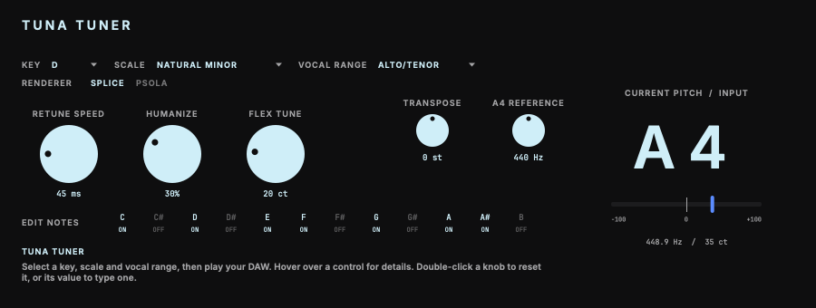

# Tuna Tuner

A monophonic vocal pitch-correction plug-in for AU and VST3.<br>
Part of the codycodie legacy release collection.

Tuna Tuner tracks the pitch of one lead vocal line, finds the nearest allowed note in the key and scale you choose, and moves the voice toward it. Pitch is detected with WORLD-based analysis and shifted with one of two waveform-based renderers, Splice or PSOLA. The default tolerances, the 130–700 Hz Alto/Tenor range and the 320 ms latency are values chosen for this plug-in, not measurements of any other product.



This release has its own plug-in identity: bundle ID `com.c0dypeng.tunatuner`, manufacturer code `Cdpg`, plug-in code `Tuna`. It builds as AU and VST3 for macOS; the source also builds a Windows VST3, which is not released (see Downloads). There is no Standalone format. The parameter IDs, order, ranges, defaults and the `CodyPitchState` saved-state format are the same as in the original development source, so compatible state can be transferred between the two. Existing DAW sessions keep identifying the original plug-in and are not replaced automatically.

## Downloads

Get the latest package from the [Tuna Tuner releases page](https://github.com/chijenpeng/tuna-tuner/releases/latest). It contains Universal AU and VST3 bundles for Apple Silicon and Intel Macs, ad-hoc signed and not notarized. There is no Windows package: the Windows x64 build compiles, but its real-time engine test fails with worker underruns on the Windows build machine, so a Windows build is not offered.

The original and this release both install as `Tuna Tuner.component` and `Tuna Tuner.vst3`. If the original is installed, move or rename its bundles before copying these, or the copy replaces them.

## Controls

| Control | Function |
| --- | --- |
| Key, Scale, Vocal Range | Set target notes and detection range. Alto/Tenor is the default, with a range of 130–700 Hz chosen for this plug-in. |
| Retune Speed | Set how quickly notes move toward their targets. |
| Humanize | Relax correction on held notes. |
| Flex Tune | Leave small deviations near the target alone, using this plug-in's own tolerance rules. |
| Renderer | Choose Splice (default) or PSOLA, two waveform-based pitch-shifting methods. |
| Edit Notes | Set each pitch class across octaves to Follow Key & Scale, On, Remove, or Bypass. |
| Transpose, A4 Reference | Shift corrected notes by semitones and set the tuning reference. |

Hold Shift while dragging a knob for fine adjustment. Double-click a knob to reset it or type a value. Hover over a control for help at the bottom left of the editor. The large note display reports the detected input pitch; the cents meter shows its difference from the selected target, not a measured output pitch. Bypass keeps that source-pitch region dry, including from Transpose. If no target notes remain enabled, the segment falls back to dry. Unvoiced material such as breaths and plosives is kept dry where possible.

## Limits

- Latency is fixed at 320 ms (15,360 samples at 48 kHz).
- Monophonic: one lead line. It is not intended for harmonies or stacked vocals.
- There is no formant correction.
- Pitch shifting can move audio within a phrase by up to about 80 ms. If drift exceeds the renderer limit, the engine can force a seam inside voiced audio, and large sustained shifts can produce audible stutter or repetition at these seams.
- Amount, Expression and Transition remain in saved state for compatibility but are ignored; internally they are fixed at 100%, 0% and 0 ms.
- Mono and stereo tracks are supported. Stereo correction follows the mid signal and leaves the side signal unchanged.
- Under heavy CPU load the real-time worker can fall behind and drop audio. On a machine whose
  cores were mostly busy with other work, `realtime_engine_test` reported worker underruns in most
  runs; it passes on a lightly loaded machine. Timing has not been qualified in a DAW.

## Build

The project requires CMake 3.22 or later and a C++17 compiler. For AU and VST3 builds, use macOS 11 or later; the Windows VST3 release uses native x64 MSVC from Visual Studio 2022. It uses JUCE 8.0.9 and WORLD at a pinned revision. Put a local JUCE checkout at `third_party/JUCE` to avoid a fetch; otherwise CMake downloads the tagged release while configuring. WORLD is always fetched.

```sh
cmake -S . -B build-release -G Ninja -DCMAKE_BUILD_TYPE=Release -DCMAKE_OSX_ARCHITECTURES="arm64;x86_64"
cmake --build build-release -j2
ctest --test-dir build-release --output-on-failure
```

On Windows, configure with `cmake -S . -B build -G "Visual Studio 17 2022" -A x64 -DCOPY_PLUGIN_AFTER_BUILD=OFF`, then build with `cmake --build build --config Release --parallel 2` and test with `ctest --test-dir build -C Release --output-on-failure`.

Plug-in copying is disabled by default, so builds stay in the build tree and do not touch installed plug-ins. To copy the bundles into the current user's Audio Plug-Ins folders, configure with `-DCOPY_PLUGIN_AFTER_BUILD=ON`. Build products are under `build-release/CodyPitch_artefacts/Release`.

## Validation and snapshots

CTest runs these checks: `realtime_pacer_test` (the timing helper used by the real-time tests), `cody_pitch_test` (pitch tracking, target selection and rendering), `realtime_engine_test` and `latency_test` (streaming engine behaviour and the fixed 320 ms latency; `latency_test_world` repeats it with the WORLD renderer), `waveform_renderer_test` (Splice and PSOLA waveform rendering; sections that need reference audio or a quiet machine skip and say so), `voicing_bridge_test`, `ui_string_test` (help and label copy) and `processor_contract_test` (parameter IDs, order, ranges and defaults, saved-state round trip, state without a Renderer value, and mono and stereo buses).

The snapshot tool renders the editor with demonstration data:

```sh
cmake --build build-release --target editor_preview
./build-release/editor_preview docs/editor.png --demo
```

On macOS, `tools/package_macos.sh` builds the AU and VST3 targets from a clean commit and writes `Tuna-Tuner-0.5.0-macos-universal.zip` and a `.sha256` companion under `build-release/dist/`. It checks identity, architectures, signatures and archive integrity.

Third-party notices and the project source-license status are in [THIRD_PARTY_NOTICES.md](THIRD_PARTY_NOTICES.md).
